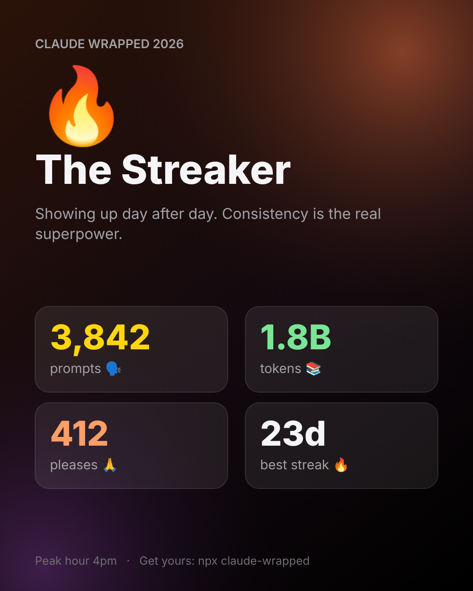

# Claude Wrapped

**Your Claude Code year in review, Spotify-Wrapped style.** One command turns your Claude Code history into a scroll-through story and a shareable card. It runs 100% on your machine.



```bash
npx claude-code-wrapped            # reads ~/.claude/projects and opens your story
npx claude-code-wrapped --demo     # preview with fake data
```

Requires Node 18 or newer. No install, no account, no API key.

## What you get
- **Totals:** prompts, sessions, active days, hours with Claude, best streak
- **Tokens** moved, in "copies of *War and Peace*"
- **Manners:** how many times you said please, thanks, sorry, and swore
- **Rhythm:** peak hour, busiest day, night-owl score
- **Year heatmap:** a GitHub-style calendar of your active days
- **Languages** Claude wrote for you, top tools, most-edited file, favorite words
- **Badges:** 11 achievements, such as Marathoner, Night Owl and Polite Human
- **A personality:** Builder, Night Owl, Gentleman, Architect, Minimalist, Streaker or Pressure Cooker
- **A 1080x1350 PNG card** and a copy-paste caption

## FAQ

### What is Claude Wrapped?
A free, open-source command-line tool that summarizes your Claude Code usage for the year, like Spotify Wrapped does for music.

### Where does it get my data?
From the transcript files Claude Code already saves on your computer in `~/.claude/projects`. It reads them locally.

### Is my data uploaded anywhere?
No. It makes no network calls and has zero dependencies. The share card and caption contain only totals, with no prompt text and no project names.

### How do I see last year's stats?
Run `npx claude-code-wrapped --year 2025`.

### Does it work with the Claude desktop app or claude.ai chats?
No. It reads Claude Code transcripts only.

### Are the stats exact?
Prompt, session and token counts come straight from your transcripts. Words like "please" are matched by simple text rules, and "hours with Claude" is estimated from session start and end times.

## Options
| Flag | What it does |
|---|---|
| `--year 2025` | Summarize a different year |
| `--dir <path>` | Use another transcripts folder |
| `--out file.html` | Choose the output file |
| `--json` | Print raw stats instead of HTML |
| `--no-open` | Do not open the browser |
| `--demo` | Use fake data |

## Develop
```bash
npm test
npm run demo
```

Issues and ideas welcome. MIT licensed.
